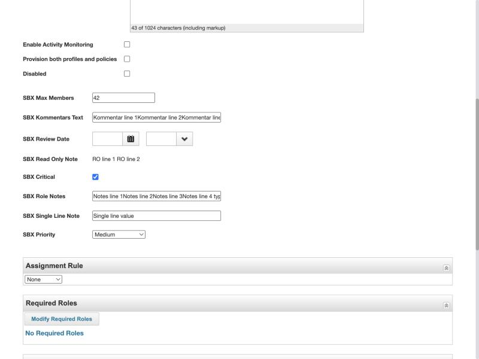
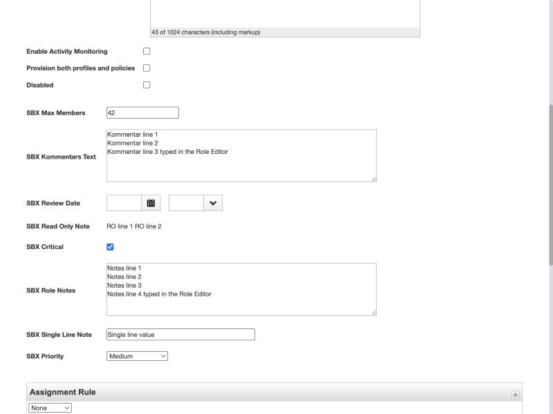
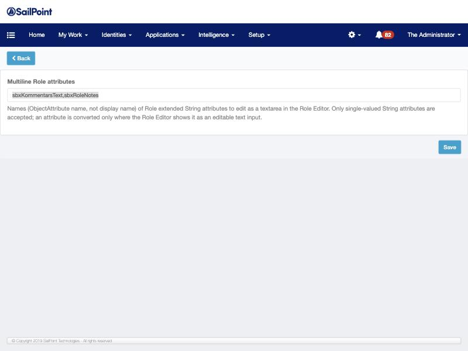

# IdentityIQ Role Editor – multiline textarea for Role extended attributes

A small SailPoint IdentityIQ plugin that lets an administrator choose which **Role (Bundle) extended String attributes** are edited in a multiline `<textarea>` in the classic Role Editor, instead of the stock single-line input.

> **Unofficial community plugin.** It is not developed, supported or endorsed by SailPoint. "SailPoint" and "IdentityIQ" are trademarks of their owner. Test it in a non-production environment first and use it at your own risk.

| | |
|---|---|
| Plugin name | `RoleTextarea` (shown in IdentityIQ as *Role Extended Attribute Textarea*) |
| Version | **1.2.0** |
| Tested on | IdentityIQ **8.0** (build `31069ce`, May 2019, no patch level shown), Apache Tomcat 9, Java 8, MySQL 8, Chromium-based browser |
| Modifies IdentityIQ product files | No |
| License | MIT (see [LICENSE](LICENSE)) |

---

## Contents

1. [Overview](#1-overview)
2. [Why a plugin is needed](#2-why-a-plugin-is-needed)
3. [Architecture](#3-architecture)
4. [Source structure](#4-source-structure)
5. [Build](#5-build)
6. [Installation](#6-installation)
7. [Configuration](#7-configuration)
8. [Permissions](#8-permissions)
9. [Multiline and newline behaviour](#9-multiline-and-newline-behaviour)
10. [Testing](#10-testing)
11. [Upgrade behaviour](#11-upgrade-behaviour)
12. [Troubleshooting](#12-troubleshooting)
13. [Uninstall and rollback](#13-uninstall-and-rollback)
14. [Compatibility and limitations](#14-compatibility-and-limitations)
15. [Security considerations](#15-security-considerations)
16. [Screenshots](#16-screenshots)

---

## 1. Overview

### The problem

A Role extended attribute of type String, such as a comment or notes field, is rendered in the Role Editor as a single-line text box:

```
Comments:  [______________________________]
```

Users who want to enter several lines (like they can in the Role *Description*) cannot. Worse, if such an attribute already contains line breaks (set by an import, a rule or the API), simply opening the role and saving it in the stock Role Editor **removes the line breaks** (see [section 9](#9-multiline-and-newline-behaviour)).

### What the plugin does

An administrator lists attribute names in the plugin configuration, for example:

```
commentsText,roleNotes
```

In the Role Editor, only those attributes are shown as a textarea. Every other attribute is left exactly as IdentityIQ renders it.

| Stock Role Editor | With the plugin |
|---|---|
|  |  |
| Plugin disabled. "SBX Kommentars Text" and "SBX Role Notes" hold several lines, but the inputs show them run together. | Same role, plugin enabled. The two configured attributes are textareas. The unconfigured String, the int, date, boolean, dropdown and read-only attributes are unchanged. |

---

## 2. Why a plugin is needed

Everything in this section was established by reading the IdentityIQ 8.0 web files and classes, and then confirmed in a running 8.0 instance. File and class names are given so you can check them in your own installation; no SailPoint source is reproduced here.

### How the Role Editor renders extended attributes

* The classic Role Editor page is `define/roles/modeler/roleEditor.xhtml` (URL `/define/roles/modeler/roleEditor.jsf`).
* It includes the generic attribute editor `include/attributeEditor.xhtml`, which includes `include/attributesEditorByCategory.xhtml` once per attribute category. The same templates are shared by other object editors.
* `attributesEditorByCategory.xhtml` chooses the widget from the attribute **type**, whether it is **editable**, and whether it has **allowed values**. For a String attribute there are exactly three outcomes:

  | Attribute definition | Rendered as |
  |---|---|
  | editable, no allowed values | single-line text input (fixed width) |
  | editable, with allowed values | dropdown |
  | not editable | plain text |

  Other branches handle identity, secret, long, int, boolean, date and rule types. **No branch renders a textarea.**
* "Editable" comes from `sailpoint.web.system.ObjectAttributeDTO.isEditable()`: the attribute's `editMode` must be set and must not be `ReadOnly`. **An attribute with no `editMode` is read-only in the Role Editor.**
* Each row contains a hidden element carrying the attribute's internal name (`span.attributeName`) inside the table `#roleAttributeEditorTable`. The plugin uses this to find the rows.
* On save, `sailpoint.web.AttributeEditBean.commit()` copies the submitted value into the role's attribute map without altering it.

### Why ObjectConfig alone cannot do it (IdentityIQ 8.0)

* The template has no textarea branch, so there is nothing for a setting to switch on.
* `sailpoint.object.ObjectAttribute` has no free-form attributes map in 8.0, so there is nowhere to store a display hint. Its properties are name, display name, type, multi, description, category, required, default value, allowed values, edit mode, and a few system/source/listener properties.
* `ObjectAttributeDTO`, the object the template actually reads, exposes no display-type or format property.
* The available types are string, secret, long, int, boolean, date, permission, rule, identity and similar object types. There is no "text" or "multiline" type.
* The only definition properties that change the String widget are `editMode` (read-only text vs input) and allowed values (input vs dropdown). Both were tried.

### Why the Description field is different

The Role Description does not go through the attribute templates at all, and it is not a textarea either.

* `roleEditor.xhtml` contains an empty container (`roleDescriptionHTML`) and a hidden field holding the descriptions as JSON.
* `scripts/sailpoint/web/define/modeler/roleEditor.js` builds a JavaScript rich-text editor into that container: `SailPoint.MultiLanguageHtmlEditor` (see `scripts/sailpoint/form/MultiLanguageHtmlEditor.js` and `HtmlEditor.js`). On save, the editor's HTML is copied back into the hidden field.
* The description is stored as **HTML** per locale. Pressing Enter in the editor inserts a `<br>`, not a newline character. A plain newline in an imported description is displayed, and saved again, as a space.

So Description supports line breaks because it is an HTML editor, which is a different mechanism from extended attributes.

### Files and classes referenced

| File / class | Role |
|---|---|
| `define/roles/modeler/roleEditor.xhtml` | Role Editor page |
| `include/attributeEditor.xhtml`, `include/attributesEditorByCategory.xhtml` | Generic extended attribute editor; widget selection |
| `scripts/sailpoint/web/define/modeler/roleEditor.js` | Builds the Description editor |
| `scripts/sailpoint/form/HtmlEditor.js`, `MultiLanguageHtmlEditor.js` | Rich-text editor used for Description |
| `include/plugins.xhtml`, `plugins/pluginHelper.xhtml` | Load plugin snippets; provide `PluginHelper` (CSRF token, REST URL helper) |
| `sailpoint.web.AttributeEditBean` | Backing bean; `commit()` stores the posted values |
| `sailpoint.web.system.ObjectAttributeDTO` | `isEditable()` |
| `sailpoint.object.ObjectAttribute`, `ObjectConfig` | Attribute definitions |
| `sailpoint.rest.PluginResource` | Built-in plugin settings REST; requires `FullAccessPlugin` |
| `sailpoint.rest.plugin.BasePluginResource`, `AllowAll`, `PluginResourceUtil` | Plugin REST base class and authorization |
| `sailpoint.rest.RestCsrfValidationFilter` | CSRF check on REST calls |
| `sailpoint.server.PluginSyncService` | Propagates plugin changes to running servers |

---

## 3. Architecture

```
IIQ determines whether the user can edit the Role
                ↓
IIQ renders editable extended attributes
                ↓
Plugin reads configured multiline attributes
                ↓
Configured editable String input?
         ↓ Yes              ↓ No
      textarea            unchanged
```

**The plugin does not grant, modify or bypass any IdentityIQ permission.** IdentityIQ alone decides who can open the Role Editor, which roles a user may edit and which attributes are editable. The plugin only changes the shape of a text input that IdentityIQ has already rendered as editable.

Components:

| Component | What it does |
|---|---|
| Plugin setting `multilineAttributes` | Comma-separated list of attribute names, edited in the plugin configuration page |
| REST resource `GET /plugin/rest/roletextarea/config` | Returns the configured names to the page. Read-only. Drops names that are not single-valued String attributes |
| Page snippet `ui/js/roleTextarea.js` | Loaded only on the Role Editor page. Fetches the list and replaces the matching text inputs with textareas |

Why a REST resource is required: the built-in settings endpoint (`/rest/plugins/{id}/settings`, used by `PluginHelper.retrieveSettings`) requires the `FullAccessPlugin` right. A normal role manager receives HTTP 401 from it, so the page cannot read plugin settings without the plugin providing its own endpoint.

Why the REST resource checks the attribute type: the Role Editor also renders **int, long and date** attributes as `<input type="text">`. The page alone cannot tell those apart from a String input, so the endpoint drops any name that is not a single-valued String attribute. This is a check of the attribute definition only; it does not look at the user, rights, edit mode or allowed values.

How the swap works:

* The snippet looks for the row whose hidden attribute name matches, and for an `<input type="text">` in it. If there is none, or it is `disabled` or `readOnly`, nothing happens.
* The new textarea gets the **same `name`** as the input, so IdentityIQ processes the submitted value exactly as it would for the original field.
* The textarea is filled from the input's original `value` attribute (which still contains the line breaks), not from the input's live value (from which the browser has already removed them).
* If the configuration request fails or returns an empty list, the page is left untouched.

---

## 4. Source structure

```
.
├── README.md
├── LICENSE
├── CHANGELOG.md
├── .gitignore
├── build.sh                         build script (javac + jar + zip)
├── plugin/                          files copied into the plugin zip as-is
│   ├── manifest.xml                 plugin definition
│   └── ui/js/roleTextarea.js        page snippet
├── src/roletextarea/rest/
│   └── RoleTextareaResource.java    REST resource
├── examples/
│   ├── role-attributes.fragment.xml example attribute definitions
│   └── test-attributes.fragment.xml attribute set used for the tests
└── docs/images/                     screenshots
```

| File | Purpose |
|---|---|
| `plugin/manifest.xml` | Declares the plugin (name, version, minimum system version), the `multilineAttributes` setting (String, multi-value, with label and help text), the REST resource class, and the snippet with its page pattern `/define/roles/modeler/roleEditor\.jsf` and script |
| `src/roletextarea/rest/RoleTextareaResource.java` | `GET roletextarea/config`, annotated `@AllowAll`. Reads the setting, keeps names that are single-valued String Role attributes, returns `{"multilineAttributes":[...], "rejected":{name: reason}}`. Rejected names are logged at WARN |
| `plugin/ui/js/roleTextarea.js` | Fetches the config with the CSRF header and swaps the matching inputs. Re-applies if the attribute table is re-rendered |
| `build.sh` | Compiles the Java class against your IdentityIQ jars, packages `lib/roletextarea.jar`, and zips the plugin |
| `examples/*.fragment.xml` | Attribute definitions to merge into your Bundle ObjectConfig. **Fragments only; do not import them as files** |

There is no CSS file and no database script. The plugin needs no plugin database tables.

The attribute names starting with `sbx` in `examples/test-attributes.fragment.xml` and in the screenshots are just the test attributes used during development; the plugin itself has no dependency on them.

If you rename the plugin, change the plugin name in `manifest.xml`, `PLUGIN_NAME` and `@Path` in the Java class, and `CONFIG_PATH` in the JavaScript together, and re-test.

---

## 5. Build

### Prerequisites

* A JDK. **JDK 8 is what the tested build used** (the tested IdentityIQ 8.0 instance runs on Java 8). The script compiles with `-source 1.8 -target 1.8`. A JDK 24 compiler also produced Java 8 bytecode with these options (with warnings), but that output was not deployed or tested.
* `zip` and a POSIX shell (Linux, macOS, WSL or Git Bash).
* Access to the jars of your own IdentityIQ installation, as compile-time classpath only.

### Required IdentityIQ jars

The Java class needs these on the compile classpath. All are found in `WEB-INF/lib` of the IdentityIQ web application:

| Needed for | Jar in IdentityIQ 8.0 |
|---|---|
| `sailpoint.*` classes | `identityiq.jar` |
| JAX-RS annotations (`javax.ws.rs.*`) | `jaxrs-ri-2.22.2.jar` |
| Commons Logging | `commons-logging-1.2.jar` |

Jar file names can differ in other IdentityIQ versions, so `build.sh` simply puts every jar in that directory on the classpath.

**These jars are SailPoint's licensed software. Do not copy them into this repository or into the plugin zip.** The build only reads them.

### Build with the script

```bash
IIQ_HOME=/path/to/identityiq ./build.sh
```

`IIQ_HOME` is the exploded IdentityIQ web application (the directory containing `WEB-INF`). Alternatively set `IIQ_LIB` to a directory containing the IdentityIQ jars.

### Equivalent manual commands

```bash
mkdir -p build/classes build/zip/lib dist
javac -source 1.8 -target 1.8 -encoding UTF-8 -cp "$IIQ_HOME/WEB-INF/lib/*" -d build/classes src/roletextarea/rest/RoleTextareaResource.java
jar cf build/zip/lib/roletextarea.jar -C build/classes .
cp -R plugin/. build/zip/
(cd build/zip && zip -qr ../../dist/RoleTextarea-1.2.0.zip manifest.xml ui lib)
```

### Expected zip structure

`manifest.xml` must be at the root of the zip:

```
RoleTextarea-1.2.0.zip
├── manifest.xml
├── ui/js/roleTextarea.js
└── lib/roletextarea.jar
```

### Verify the build

```bash
unzip -l dist/RoleTextarea-1.2.0.zip
unzip -p dist/RoleTextarea-1.2.0.zip lib/roletextarea.jar > /tmp/roletextarea.jar && unzip -l /tmp/roletextarea.jar
```

The jar must contain exactly `roletextarea/rest/RoleTextareaResource.class` (plus `META-INF`). The zip must not contain any IdentityIQ jar.

---

## 6. Installation

Prerequisite: plugins must be enabled in IdentityIQ (`plugins.enabled=true` in `iiq.properties`), and the plugin data source must be configured as for any plugin.

### Option A – IdentityIQ user interface

1. Log in as a user with plugin administration rights (for example System Administrator).
2. Gear menu → **Plugins**.
3. **New**, then choose or drop `RoleTextarea-1.2.0.zip`.
4. The plugin appears as *Role Extended Attribute Textarea*, enabled.

This is the standard IdentityIQ installation path. *The tests in this project installed through the console (option B); the UI upload itself was not exercised.*

### Option B – IdentityIQ console

```
plugin install /path/to/RoleTextarea-1.2.0.zip
plugin list
```

A console installation is written to the database by a different JVM. In the tested environment the running application server picked up the plugin and its JavaScript through the Plugin Sync service within about a minute, without a restart. **The REST endpoint, however, returned 404 until the plugin was disabled and re-enabled once in the Plugins page** (see [section 11](#11-upgrade-behaviour)).

### After installing

* The plugin is enabled by default. Until `multilineAttributes` is configured it does nothing.
* Check the REST endpoint (see [section 7](#7-configuration)). If it returns 404 after a console installation, disable and re-enable the plugin under Gear → Plugins.
* No server restart was needed in the tested environment.
* Reload the Role Editor page in the browser (a hard refresh if in doubt).

---

## 7. Configuration

1. Gear menu → **Plugins** → *Role Extended Attribute Textarea* → **Configure**.
2. In **Multiline Role attributes**, enter the attribute names separated by commas:

   ```
   commentsText,roleNotes
   ```

3. **Save**.



Notes:

* Use the **internal attribute name** (the `name` of the ObjectAttribute in the Bundle ObjectConfig), **not the display name**. Names are case-sensitive.
* **Only the listed attributes become textareas.** Everything else stays as IdentityIQ renders it.
* The change takes effect the next time the Role Editor page is loaded. No rebuild, upgrade or restart is needed.
* The configuration page requires plugin administration rights (`FullAccessPlugin`).
* The configuration page does not validate the names. To see what the plugin accepted and rejected, run this in the browser console on any classic IdentityIQ page while logged in:

  ```js
  fetch(PluginHelper.getPluginRestUrl('roletextarea/config'), {headers: {'X-XSRF-TOKEN': PluginHelper.getCsrfToken()}}).then(r => r.json()).then(console.log)
  ```

  Example response:

  ```json
  {
    "multilineAttributes": ["commentsText", "roleNotes"],
    "rejected": {"reviewDate": "type is date, not string", "typoName": "not a Role extended attribute"}
  }
  ```

### Requirements for an attribute

For an attribute to appear as a textarea, IdentityIQ must render it as an editable single-line text input. That means, in the Bundle (Role) ObjectConfig:

* `type="string"`, single-valued
* `editMode="Permanent"` (or `UntilFeedValueChanges`); with no edit mode IdentityIQ 8.0 shows the attribute as read-only text
* no allowed values (otherwise IdentityIQ shows a dropdown)

See [`examples/role-attributes.fragment.xml`](examples/role-attributes.fragment.xml).

---

## 8. Permissions

* **`@AllowAll` on the REST method.** IdentityIQ requires every plugin REST endpoint to carry an authorization annotation; without one the request is refused. `@AllowAll` means "any authenticated IdentityIQ user". The alternatives (`@RequiredRight`, `@SystemAdmin`) would restrict the endpoint to users holding a specific right.
* **Authenticated users only.** `/plugin/rest/*` is behind IdentityIQ's REST authentication and CSRF filters. An unauthenticated request gets HTTP 401. A request without a valid CSRF token is rejected.
* **Why a normal role manager can read the configuration.** The plugin's own endpoint does not require plugin administration rights, so anyone who legitimately reaches the Role Editor gets the list. This is necessary because the built-in plugin settings endpoint requires `FullAccessPlugin`.
* **IdentityIQ remains responsible for Role authorization.** The plugin contains no rights, capability or scope checks. The snippet is loaded on the Role Editor page only, and that page is reachable only by users IdentityIQ allows.
* **The plugin does not make read-only fields editable.** It converts an existing, enabled text input. Where IdentityIQ renders plain text, a dropdown or a disabled field, the plugin does nothing, even if the attribute is listed in the configuration.

---

## 9. Multiline and newline behaviour

* **Storage.** A String extended attribute can hold newline characters. Values set by XML import or by a rule (`setAttribute("name", "line 1\nline 2")`) are stored with their line breaks. A non-searchable extended attribute lives in the role's attributes map.
* **Stock Role Editor display.** IdentityIQ sends the stored value, including line breaks, in the input's `value` attribute. Browsers strip line breaks from the live value of `<input type="text">`, so the field shows the lines run together (`Line oneLine twoLine three`).
* **Stock Role Editor data loss (reproduced).** Opening a role whose attribute contains line breaks and pressing **Submit without changing anything** rewrote the stored value without the line breaks. Any multiline value set by import, rule or API is flattened the next time someone saves the role in the stock editor.
* **With the plugin.** The textarea is filled from the original `value` attribute, so the line breaks are shown and preserved on save.
* **CRLF.** Browsers submit textarea line breaks as carriage return + line feed. Values saved through the textarea are stored with `\r\n`; values set by import or rule may contain `\n` only. Anything that consumes the attribute (rules, reports, e-mail templates) should handle both.
* **Enter key.** Pressing Enter in the textarea adds a line; it does not submit the Role Editor form.
* **Read-only displays.** The Role Viewer and other read-only views show the value as plain text with line breaks collapsed to spaces. The plugin does not change those views.

> **Important.** If you remove an attribute from the configuration (or disable or uninstall the plugin) while roles still hold multiline values in it, the stock data-loss behaviour returns for that attribute.

---

## 10. Testing

All tests were run in one non-production IdentityIQ 8.0 instance (single node, Tomcat 9, Java 8, MySQL 8, Chromium-based browser).

The plugin was developed under a different internal name and renamed to `RoleTextarea` for publication. Versions 1.1.0 and 1.1.1 below were tested under the earlier name; **1.2.0 is the published version** and differs from 1.1.1 only in names (plugin name, REST path, Java package, jar and zip names). The tables say which version each test was run on.

Evidence levels used below:

* **Code** – established by reading IdentityIQ 8.0 files or classes.
* **Sandbox** – observed in the running instance.
* **Assumption** – expected, but not tested.

### Test setup

* Role attributes from [`examples/test-attributes.fragment.xml`](examples/test-attributes.fragment.xml): two editable Strings to configure, one editable String left unconfigured, a String with allowed values, a String without edit mode, a date, a boolean and an int.
* One business role with multiline values seeded by a rule.
* An administrator, and a **non-admin role manager** holding only the `BusinessRoleAdministrator` capability (no plugin rights).

### Findings established from code

| Finding | Level |
|---|---|
| String attributes render as input, dropdown or plain text only; no textarea branch | Code, Sandbox |
| An attribute without `editMode` is read-only in the Role Editor | Code, Sandbox |
| ObjectAttribute has no display-hint property in 8.0 | Code |
| Description is an HTML rich-text editor; Enter produces `<br>` | Code, Sandbox |
| `AttributeEditBean.commit()` stores the posted value unchanged | Code, Sandbox (stored values checked after each save) |
| Built-in plugin settings endpoint requires `FullAccessPlugin` | Code, Sandbox (401 for the role manager) |
| A plugin REST endpoint without an authorization annotation is refused | Code |

### Sandbox tests – stock behaviour (no plugin)

| # | Test | Result |
|---|---|---|
| S1 | Attribute defined without `editMode` | Read-only text in the Role Editor |
| S2 | Same attribute with `editMode="Permanent"` | Single-line input; a three-line value shown as `Line oneLine twoLine three` |
| S3 | Store newlines by XML import and by rule | Stored with line breaks |
| S4 | Open the role in the stock editor and Submit unchanged | **Line breaks removed from the stored value** |

### Sandbox tests – version 1.1.0 (earlier name; configuration, REST, save)

| # | Test | Result |
|---|---|---|
| T1 | REST call with a valid CSRF token, setting empty | 200, empty list; Role Editor unchanged |
| T2 | REST call with no token, and with a wrong token | Rejected (CSRF validation failure in the server log) |
| T3 | Configuration page | Label, help text and one text field; saving `a, b,c` stores `a,b,c` |
| T4 | Two configured Strings | Both rendered as textareas |
| T5 | Unconfigured String | Normal single-line input |
| T6 | int, boolean, date, dropdown, read-only attributes | Unchanged |
| T7 | Type a new line in both textareas with the keyboard; change the single-line, int and dropdown fields; Submit | Saved. Both values stored with their line breaks (CRLF); the other fields saved normally |
| T8 | Reopen the role | All lines shown in both textareas |
| T9 | Change the configured list in the UI (remove one attribute, add another) | Effective on the next Role Editor load; no rebuild or restart |
| T10 | Non-admin role manager: REST | Plugin endpoint 200; built-in settings endpoint 401 |
| T11 | Non-admin role manager: open the business role, add a line, Submit | Same widgets as the administrator; saved with line breaks |

### Sandbox tests – version 1.1.1 (earlier name)

| # | Test | Result |
|---|---|---|
| F1 | Upgrade 1.1.0 → 1.1.1 from the console | Version updated; configured setting value kept. REST class needed a disable/enable to reload (see [section 11](#11-upgrade-behaviour)) |
| F2 | Configure two real Strings plus a read-only String, a dropdown String, a date, an int and a non-existent name | Endpoint accepts the four String names; rejects the date, the int and the unknown name with a reason |
| F3 | Role Editor with that configuration | The two editable Strings are textareas. The read-only String stays plain text and the dropdown stays a dropdown. Date, int, boolean and the unconfigured String unchanged |
| F4 | Unauthenticated request to the endpoint | 401 |
| F5 | Non-admin role manager: REST and Role Editor | Endpoint 200 with the same list; built-in settings endpoint 401; same widgets as the administrator |
| F6 | Non-admin role manager selects a role of a type they may not manage | IdentityIQ disables **Edit Role**; the plugin is not involved |
| F7 | Disable the plugin, open the Role Editor | Snippet not loaded, endpoint 404, both attributes are stock single-line inputs |
| F8 | Re-enable the plugin | Endpoint 200 with the configured list; setting kept |
| F9 | **Final multiline save and reopen**, as the non-admin role manager: type a new line into both textareas with the keyboard, Submit | Saved. Stored values have 4 and 6 lines (CRLF). Read-only attribute's value untouched |
| F10 | Reopen the role | Both textareas show all lines |

### Sandbox tests – version 1.2.0 (`RoleTextarea`, the published build)

Built with JDK 8 from this repository and installed from the console. Configuration: `sbxKommentarsText,sbxRoleNotes`.

| # | Test | Result |
|---|---|---|
| R1 | Build with `build.sh` (JDK 8) | `RoleTextarea-1.2.0.zip` with `manifest.xml`, `ui/js/roleTextarea.js`, `lib/roletextarea.jar` |
| R2 | Console `plugin install` into the running server | Plugin listed and enabled, JavaScript served. REST endpoint returned **404** until the plugin was disabled and re-enabled once (see [section 11](#11-upgrade-behaviour)); then 200 |
| R3 | Configure the two attributes in the Plugins UI | Saved; endpoint returns both names |
| R4 | Role Editor as administrator | Both configured attributes are textareas |
| R5 | Unconfigured String attribute | Still a single-line input. int, date, boolean, dropdown and read-only attributes unchanged |
| R6 | Non-admin role manager: endpoint and Role Editor | Endpoint 200 with the list; same widgets as the administrator |
| R7 | **Multiline save and reopen** as the non-admin role manager: typed a new line into both textareas with the keyboard, Submit | Saved. Stored values have 3 and 4 lines (CRLF); the read-only attribute's value untouched. After reopening, both textareas show all lines (screenshot 03) |
| R8 | Non-admin role manager selects a role of a type they may not manage | IdentityIQ disables **Edit Role** and **Delete**; the plugin snippet is not on that page |
| R9 | Disable the plugin, open the Role Editor | Snippet not loaded, endpoint 404, both attributes are stock single-line inputs (screenshot 01) |
| R10 | Re-enable the plugin | Endpoint 200, configuration kept, textareas back |

Not repeated on 1.2.0 (run on 1.1.x only): the CSRF-rejection test (T2), changing the list at runtime (T9), the built-in settings endpoint returning 401 for the role manager (T10, F5), and listing read-only, dropdown and non-string attributes in the configuration (F2, F3).

### Not tested (assumptions and limitations)

* Installing through the Plugins UI upload (console install was used for every version).
* Uninstalling the plugin (disabling it was tested, F7).
* Clustered environments. A settings change is expected to reach other nodes through the Plugin Sync service.
* The snippet re-applies the swap if the attribute table is re-rendered by an AJAX update. In the test, changing the role type did not re-render the table, so this path was not exercised.
* Other browsers, other IdentityIQ versions and patch levels, other application servers and databases.
* Attributes placed in a category, and roles going through a role-change approval workflow.

---

## 11. Upgrade behaviour

Two observations on IdentityIQ 8.0, single node, when a plugin with a REST class is installed or upgraded **from the console while the application server is running**:

| Scenario | Observed |
|---|---|
| Console `plugin upgrade` 1.1.0 → 1.1.1 (same plugin name, Java class changed) | Version, files and JavaScript updated within about a minute; the configured setting was kept. The **REST endpoint kept running the old Java class** |
| Console `plugin install` of 1.2.0 (new plugin name, new REST path) | Plugin and JavaScript loaded within about a minute. The **new REST path returned 404** |

In both cases, **disabling and then re-enabling the plugin** in Gear → Plugins fixed it immediately, and the setting value was kept.

One earlier console installation (the first version that contained a REST class) worked without this step; the difference was not investigated.

Likely cause, from reading `sailpoint.server.PluginSyncService` in 8.0: when it loads or reloads a plugin it only requests a reload of the plugin REST container if the plugin declares service executors, which this plugin does not.

This is reported only for the version and scenarios above. It was not checked on other IdentityIQ versions, for installations or upgrades performed through the Plugins UI, or after an application server restart.

Practical advice: after installing or upgrading from the console, call the REST endpoint (see [section 7](#7-configuration)). If it returns 404 or behaves like the old version, disable and re-enable the plugin.

---

## 12. Troubleshooting

| Symptom | Likely cause and fix |
|---|---|
| Field remains a single-line input | Check, in order: the plugin is enabled; the name is listed in the configuration; the endpoint returns it under `multilineAttributes` (see [section 7](#7-configuration)); the browser has loaded `roleTextarea.js` (hard refresh) |
| Name appears under `rejected` with "not a Role extended attribute" | Wrong name. Use the internal attribute name, not the display name; names are case-sensitive |
| Name appears under `rejected` with "type is …, not string" | Only String attributes are supported |
| Endpoint returns an empty list | The configuration is empty or was not saved. Open Plugins → Configure and save the list |
| Attribute is listed and accepted, but shows as plain text | IdentityIQ renders it read-only: the attribute has no `editMode` or it is `ReadOnly`. Set `editMode="Permanent"`. The plugin never makes a read-only attribute editable |
| Attribute is listed and accepted, but shows as a dropdown | The attribute has allowed values. Remove them if free text is wanted |
| REST call returns 401 | Not logged in, or the session expired |
| REST call is redirected to an error page, or `fetch` reports a network error | Missing or wrong CSRF header. Send `X-XSRF-TOKEN` with `PluginHelper.getCsrfToken()` |
| REST call returns 403 | The endpoint has no authorization annotation (only if you modified the Java class) |
| REST call returns 404 | The plugin is disabled or not installed, or the REST path was changed. Right after a console installation: disable and re-enable the plugin ([section 11](#11-upgrade-behaviour)) |
| Plugin upgraded, but the endpoint still behaves like the old version | See [section 11](#11-upgrade-behaviour): disable and re-enable the plugin |
| Old JavaScript still running after an upgrade | The script URL's cache-buster is the IdentityIQ build number, not the plugin version. Hard-refresh the browser |
| Line breaks disappeared from a value | The role was saved while the attribute was a stock input (attribute not configured, plugin disabled, or config request failed). See [section 9](#9-multiline-and-newline-behaviour) |
| Value shows on one line in the Role Viewer | Expected; read-only views are not changed by this plugin |
| Single-line input visible for a moment on page load | Expected; the textarea appears once the configuration request returns |

Rejected names are also written to the IdentityIQ log at WARN level by `roletextarea.rest.RoleTextareaResource`.

---

## 13. Uninstall and rollback

**Before removing the plugin**, consider the attributes that hold multiline values: once they are stock inputs again, saving a role flattens them ([section 9](#9-multiline-and-newline-behaviour)).

To switch the plugin off without removing it: Gear → **Plugins** → power button on the plugin card. Tested result: the snippet is no longer loaded, the endpoint returns 404, and the Role Editor shows the stock single-line inputs.

To remove it:

* UI: Gear → **Plugins** → remove (✕) on the plugin card, or
* Console: `plugin uninstall RoleTextarea`

Then hard-refresh the browser and confirm:

1. The plugin is no longer listed under Plugins.
2. The Role Editor shows the previously configured attributes as single-line inputs.
3. `…/plugin/rest/roletextarea/config` returns 404.

The plugin creates no database tables, changes no IdentityIQ files and modifies no IdentityIQ objects other than its own Plugin object. Role attribute definitions and stored values are not touched by uninstalling. Uninstall itself was not run in the tests; disabling was.

---

## 14. Compatibility and limitations

**Tested:** IdentityIQ 8.0 (the single build listed at the top) only, classic Role Editor, single node.

**Re-test before using on any other version or patch level**, in particular:

* the Role Editor still uses the same page (`/define/roles/modeler/roleEditor.jsf`) and markup (`#roleAttributeEditorTable`, hidden `span.attributeName`, a text input per String attribute);
* plugin snippets are still loaded on that page;
* `BasePluginResource`, `@AllowAll`, `getSettingMultiString` and the `/plugin/rest/` path behave the same;
* the CSRF header and `PluginHelper` helpers are unchanged;
* whether a newer version already offers a multiline option for extended attributes, which would make this plugin unnecessary.

Limitations:

* Role (Bundle) attributes in the classic Role Editor only. Identity, application and other attribute editors are not affected, although they share the same templates.
* Read-only views are unchanged.
* The textarea has a fixed size (6 rows, 500px) and no length limit or character counter.
* The setting is global: the same list applies to every role type.
* The textarea appears after a short delay on page load.

---

## 15. Security considerations

* **No bypass of Role permissions.** The plugin adds no way to write data. The only server-side code is one read-only `GET`. Saving a role goes through the unchanged IdentityIQ form submission, with IdentityIQ's own authorization. The snippet does not add fields, enable disabled fields or change which roles can be opened.
* **What the endpoint exposes.** Only the attribute names an administrator entered in the plugin configuration, and a short reason for names it rejected. It returns no role data, no attribute values and no user information. Any authenticated user can read this list; treat the attribute names as non-secret.
* **Authentication and CSRF.** Enforced by IdentityIQ's standard REST filters, not by the plugin.
* **Input handling.** The snippet matches names by exact string comparison against text IdentityIQ rendered and builds the textarea with DOM APIs; configured names are never inserted into the page as HTML.
* **Content of the attribute.** The plugin does not sanitise what users type. A multiline value is stored as plain text, exactly as a single-line value would be. Any page, report or e-mail template that outputs the attribute must escape it, as before.
* **Supply chain.** The zip contains one compiled class and one JavaScript file. It bundles no third-party libraries and no IdentityIQ code.

---

## 16. Screenshots

| File | Shows |
|---|---|
| [`01-stock-roleeditor-single-line-inputs.jpg`](docs/images/01-stock-roleeditor-single-line-inputs.jpg) | Role Editor with the plugin disabled: multiline values shown run together in single-line inputs |
| [`02-plugin-configuration.jpg`](docs/images/02-plugin-configuration.jpg) | Plugin configuration page (version 1.2.0) |
| [`03-roleeditor-configured-textareas.jpg`](docs/images/03-roleeditor-configured-textareas.jpg) | Same role with the plugin enabled, after saving and reopening as a non-admin role manager: two configured attributes as textareas, other types unchanged |
| [`04-iiq-disables-edit-for-unauthorized-role-type.jpg`](docs/images/04-iiq-disables-edit-for-unauthorized-role-type.jpg) | IdentityIQ disabling **Edit Role** for a role type the user may not manage |

Images 01 to 03 were captured with version 1.2.0. Image 04 was captured with 1.1.1; that page is not affected by the plugin.

---

## License

MIT. See [LICENSE](LICENSE).
